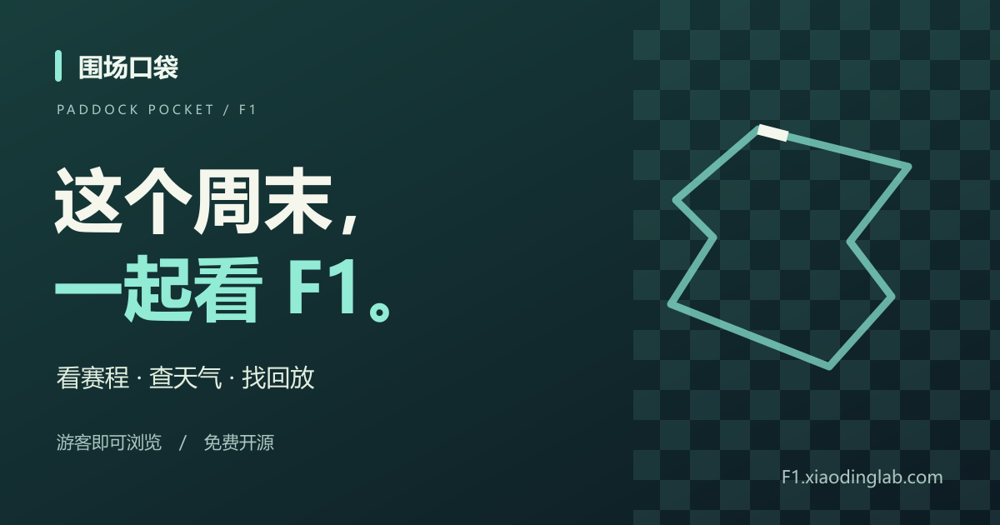
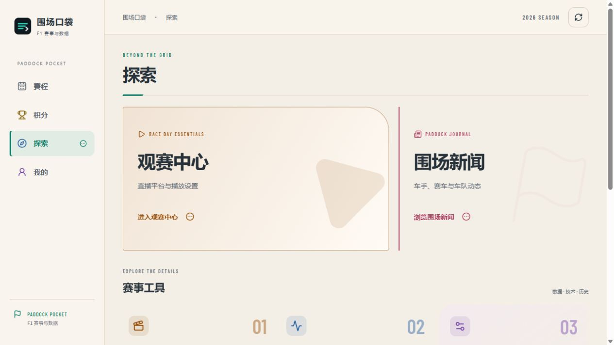

# Paddock Pocket · 围场口袋

### Every race weekend starts here.

A race and viewing companion for Formula 1 fans. **Check schedules, circuit weather and replay links without signing in.** Available on phones, tablets and desktops; accounts provide private avatars and a fan pass.

[Live application](https://F1.xiaodinglab.com/) · [Project introduction](https://f1.xiaodinglab.com/about) · [Download Android 0.7.0](https://f1.xiaodinglab.com/downloads/Paddock-Pocket-0.7.0.apk) · [User guide](docs/user-guide.en.md) · [简体中文](README.md)

[](https://github.com/yaodingyaoding-prog/paddock-pocket/actions/workflows/check.yml) [](LICENSE)



<details>
<summary>View the application</summary>



</details>

## Why Paddock Pocket

Race-weekend information is scattered across calendars, standings, weather apps and video platforms. Paddock Pocket organizes it around watching a race: start with the next weekend, check points and driver profiles, explore data or find coverage, and keep your favorite drivers on a personal podium.

The project maintains its own interface, navigation and motion, account and avatar integration, validation, cache fallbacks, Android adaptations and deployment workflow. Upstream services, references and assets are identified below.

## Features

| Feature | Experience |
| --- | --- |
| Weekend home | Next-session countdown, seasons and sessions, results, calendar exports and a directly rotatable 3D circuit |
| Standings and profiles | Top five by default, expandable full tables, season-specific car numbers, career results, title years, teams and news |
| Circuit weather | Conditions and forecasts matched to circuit coordinates and session times, with more frequent checks around sessions |
| Personal podium | Fan licence card, cropped account avatar, up to three followed drivers and separate team follows |
| Analysis | Two-driver telemetry, tyres and pit stops, race-control messages, technical material and next-round clinching conditions |
| Viewing and replays | Five Star Sports, Tencent Video web / app links, and Bilibili / Tencent searches by season, race and session |
| Discover | Paddock briefs, classic races, an F1 encyclopedia and rules |
| Appearance and motion | 10 themes, 12 accent colors, searchable time zones, glass navigation, varied page motion and a continuously animated login scene |

Schedule, Standings, Discover and Profile form the primary navigation. Analysis tools have secondary pages. Motion handles rapid navigation and respects system reduced-motion preferences.

## Start using it

1. Visit [F1.xiaodinglab.com](https://F1.xiaodinglab.com/) and browse races as a guest. Sign in or register when setting your account avatar. Passwords need at least six characters; recovery still requires email verification.
2. Choose a season or Grand Prix in Schedule (赛程), and open a driver from Standings (积分).
3. Use Discover (探索) for live coverage, replays, news and analysis.
4. Use Profile (我的) for avatars, followed drivers, themes, accents and time zones.

Avatars sync through the account. Follow lists are stored separately for each account on the current device. Signing out clears the guest podium; signing in to the same account restores its saved selection. Follows, appearance and time zones do not sync across devices. The [user guide](docs/user-guide.en.md) explains each workflow, viewing setup by device and analysis limitations.

### Android installation and updates

**[Download the 0.7.0 preview APK](https://f1.xiaodinglab.com/downloads/Paddock-Pocket-0.7.0.apk)** · [Checksum and certificate metadata](public/downloads/android-build.json) · [Changelog](CHANGELOG.md)

- Supports Android 8.0 and later. Confirm installation through Android's system prompts; existing installations can be updated in place.
- The app loads the same production website as a browser, including current accounts, interface and race features. It requires internet access. Reloading receives deployed web updates.
- Native features include a home-screen widget, system image picking, calendar saving, platform app launch and version checks.
- The widget shows the next-session countdown, weather and up to three followed drivers. Android schedules background work; the maintainer's computer does not need to stay on.
- Native updates require a new APK and user-confirmed installation. Version 0.6.0 supports in-app update checks; 0.5.0 users need a manual upgrade.

Version 0.7.0 uses package `dev.paddock.pocket`, `versionCode=7` and the same certificate as 0.6.0. This is a preview signing channel. Compilation, signing, ZIP alignment, metadata and file hashes have been checked; Android device acceptance remains pending. See the [Android release notes](docs/android-release.md).

### iPhone, iPad and Apple Watch

On iPhone and iPad, use Safari → Share → Add to Home Screen for a web shortcut. Native iOS / watchOS packages are not available. The shortcut does not include native widgets, watch-face complications or Smart Stack widgets.

Guest browsing requires no account. The schedule and personal podium have share buttons for locally generated PNG posters, system sharing and links. Posters exclude account email, member ID and private avatars. Shared lineups never overwrite the recipient’s follows.

## Local development

Use **Node.js 24** and npm:

```bash
git clone https://github.com/yaodingyaoding-prog/paddock-pocket.git
cd paddock-pocket
npm ci
npm run dev
```

Open `http://127.0.0.1:5174`. When unconfigured, `AUTH_MODE` defaults to `off` so the main race interface can be developed. Accounts and avatars require your own Supabase setup. Race and weather requests still depend on upstream network access.

| Command | Purpose |
| --- | --- |
| `npm run dev` | Start development on port 5174 |
| `npm run check` | Type and feature checks, including accounts, weather, telemetry, replays, championship conditions, motion and APK integrity |
| `npm run build` | Create the production build |
| `npm run preview` | Preview an existing build on port 5174 |
| `npm run deploy` | Deploy to Cloudflare Workers |

After changing portrait provenance, run `node scripts/build-portrait-index.mjs` and retain source records. A `127.0.0.1` address is accessible only on the computer running the server.

## Self-hosting

Account, weather and race-data endpoints require a full Cloudflare Worker deployment alongside static assets.

1. Fork the repository and change the Worker name in `wrangler.jsonc`. Remove this project's `routes` or replace them with domains you own.
2. Create your own Supabase project and SMTP configuration. Production currently uses Supabase and Resend; check the providers for current free-plan quotas.
3. Copy `.env.example` to `.dev.vars` for local account configuration. Set production runtime variables and Secrets in Cloudflare.
4. Configure the Supabase Site URL and `/auth/confirm` redirect. For avatars, review and run the private-bucket SQL once in your project.
5. Verify signup, login, recovery, avatars and anonymous endpoint protection before opening access. `AUTH_MODE=off` does not enforce login and cannot validate production access protection.

| Variable | Purpose |
| --- | --- |
| `AUTH_MODE` | `off` for development; `required` protects private routes; explicit read-only race endpoints remain public |
| `AUTH_BASE_URL` | Your application origin without a trailing slash; use HTTPS in production |
| `SUPABASE_URL` | Your Supabase Project URL |
| `SUPABASE_PUBLISHABLE_KEY` | A Publishable key starting with `sb_publishable_`; administrative keys are not required |
| `AUTH_SESSION_SECRET` | An independently generated secret of at least 32 random characters for temporary recovery grants |

Enable Email signup in Supabase. To match production, disable signup Confirm email and set the password minimum to six; recovery still uses email verification. Confirmation-required signup is also supported when configured. Set the production callback URL and your local development callback separately.

Use Resend or another supported SMTP provider for recovery email. Resend keys belong in Supabase's SMTP password field, never frontend code or Git. For avatars, execute [`docs/avatar-storage.sql`](docs/avatar-storage.sql) once after review; it creates private storage and owner-path policies. Detailed [account](docs/authentication-setup.md) and [avatar](docs/profile-features.md) notes are in Chinese.

Cloudflare Git settings: Node.js `24`, repository root `/`, build `npm run check && npm run build`, deploy `npm run deploy`. For local deployment, authenticate with `npx wrangler login`, then check, build and deploy.

With `AUTH_MODE=required`, private routes stay closed during account-service outages. Public race browsing remains available by design. Keep real environment files, keystores and local build output out of Git. See the [Android build guide](native/android/README.md) for native builds.

## Technology and layout

React 19 / TypeScript provides the interface, Vite / Vinext and Cloudflare Workers run the application, and Three.js renders circuits. Supabase Auth / Storage provides accounts and private avatars, with recovery email through SMTP. Android uses Java, WebView and AppWidget.

```text
app/                   Pages, interactions and API routes
lib/                   Race, weather, telemetry, accounts and points logic
native/android/        Android app, widget and build script
public/                Images, fonts, models, scripts and APKs
scripts/               Validation, indexing and APK publication
docs/                  User, configuration and release guides
```

## Data and current limits

- Some race, standings, driver, telemetry and technical data depends on F1Push. Fetch timestamps are not a live-timing latency guarantee. Available fallbacks retain their snapshot times; missing records are not simulated.
- Open-Meteo supplies weather. While the page is visible and online, checks run roughly every five minutes within 30 minutes of sessions, hourly when a session is within 48 hours, and every three hours otherwise. Server caching and bounded stale fallbacks also apply. A closed webpage does not keep polling.
- Replay buttons generate platform searches. The project does not host videos or guarantee full replays. Accounts, subscriptions or regional access may be required by providers.
- News is attributed Chinese editorial material; classic races are editorial selections. Historical portraits, profiles and special imagery may be incomplete.
- Championship tools currently evaluate 2026 full-points scenarios, not probabilities. Apple Sports accounts or data are not integrated.
- The interface is primarily Chinese. English documentation does not imply a fully translated application.

## Participate

[Report an issue](https://github.com/yaodingyaoding-prog/paddock-pocket/issues) or submit a pull request. Include reproduction steps and browser / OS versions. For data issues, specify the season, Grand Prix, session and driver. Run checks and the build before submitting.

[Contributing](CONTRIBUTING.md) · [Security](SECURITY.md) · [Changelog](CHANGELOG.md)

If Paddock Pocket helps you enjoy a weekend, consider giving it a Star.

## Acknowledgments and license

Thank you to [F1Push（发车格）](https://f1push.com/) for references in information organization and selected interactions, and for some upstream data services; and to [Popukok/smg_live](https://github.com/Popukok/smg_live) for the upstream Five Star Sports viewing-assistance scripts. This project maintains device adaptations, installation guidance and integration while retaining upstream attribution and licenses.

Weather, driver and team images, circuit data, fonts, scripts and dependencies retain their individual sources and rights. See [third-party notices](THIRD_PARTY_NOTICES.md). Third-party photographs, data, trademarks and videos are excluded from the original-code MIT grant.

Original project code and documentation use the [MIT License](LICENSE), `Copyright (c) 2026 yaodingyaoding-prog`. Paddock Pocket is an independent fan project, without official affiliation or endorsement from Formula 1, F1Push, Five Star Sports or the viewing platforms.
