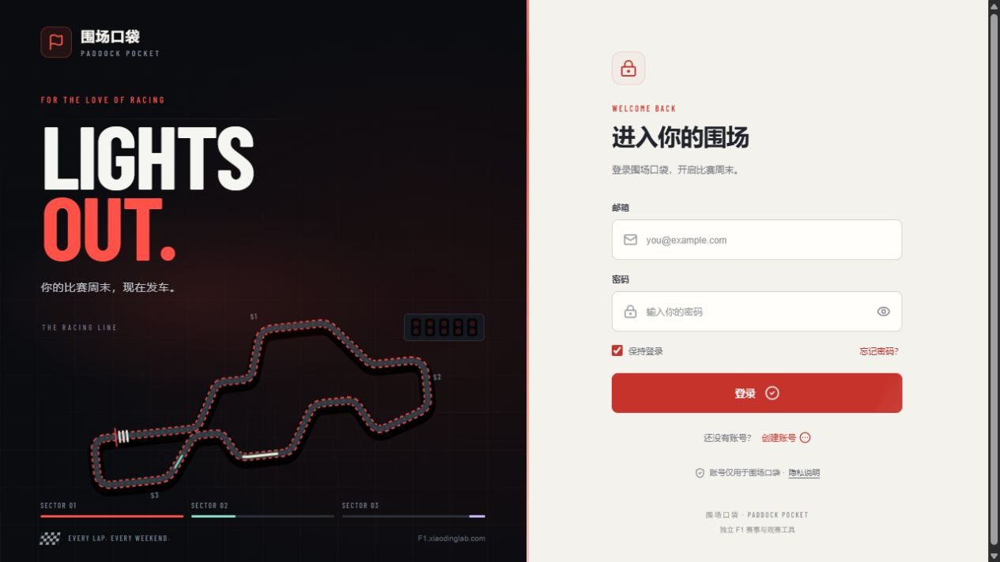

# 围场口袋 · Paddock Pocket

### 每个比赛周末，从这里开始。

一个为 F1 车迷打造的赛事与观赛应用。赛程、积分、天气、遥测和回放集中在同一个围场，手机、平板和电脑都能使用。

[在线体验](https://F1.xiaodinglab.com/) · [下载 Android 0.7.0](https://f1.xiaodinglab.com/downloads/Paddock-Pocket-0.7.0.apk) · [使用指南](docs/user-guide.md) · [English](README.en.md)

[](https://github.com/yaodingyaoding-prog/paddock-pocket/actions/workflows/check.yml) [](LICENSE)



<details>
<summary>查看应用界面</summary>


</details>

## 为什么做围场口袋

比赛周末的信息往往散落在赛历、积分榜、天气应用和视频平台里。围场口袋将它们按观赛顺序组织：先看下一站和场次安排，再看积分与车手，进入探索查数据、找直播或回放，最后在个人领奖台留住自己关注的车手。

项目维护自己的产品界面、导航与动效、账号与头像接入、数据校验、缓存回退、Android 适配及部署流程。上游数据、参考项目与第三方素材在文末分别列出。

## 功能特点

| 功能 | 体验 |
| --- | --- |
| 比赛周末首页 | 下一站倒计时、分站与场次赛程、赛果、日历导出；首页可直接旋转 3D 赛道 |
| 积分与车手档案 | 默认展示前五名，按需展开全榜；赛季车号、生涯成绩、冠军年份、车队经历和相关动态 |
| 赛道天气 | 结合赛道坐标与比赛时间，显示当前天气、逐小时预报和场次天气；比赛窗口提高刷新频率 |
| 个人领奖台 | 超级执照风格的车迷通行证、可裁剪头像、最多三位关注车手，以及独立车队关注 |
| 遥测与争冠工具 | 双车数据对比、轮胎和进站记录、赛会消息、技术资料与下一站提前夺冠条件计算 |
| 直播与回放 | 五星体育、腾讯视频网页及 App 入口；按赛季、分站和场次检索 B 站与腾讯视频回放 |
| 围场探索 | 新闻简报、经典比赛、F1 百科与规则资料 |
| 外观与交互 | 10 套主题、12 种点缀色、可搜索时区；玻璃导航、分层页面动效与持续动态登录场景 |

主导航保留赛程、积分、探索和我的四个入口，数据工具放在二级页面。动效兼顾快速连续切换，并适配系统的减少动态效果设置。

## 开始使用

1. 打开 [F1.xiaodinglab.com](https://F1.xiaodinglab.com/)，创建账号或登录。正式站注册可直接进入，密码至少 6 个字符；找回密码仍需要邮件验证。
2. 在“赛程”选择赛季或分站，在“积分”点击车手进入档案。
3. 在“探索”进入观赛中心、赛事回放、新闻或数据工具。
4. 在“我的”设置头像、关注车手、主题、点缀色与时区。

头像随账号同步。关注、主题和时区目前保存在当前设备，尚未跨设备同步。完整操作、各设备直播配置和数据工具说明见[使用指南](docs/user-guide.md)。

### Android 安装与更新

**[下载 0.7.0 预览版 APK](https://f1.xiaodinglab.com/downloads/Paddock-Pocket-0.7.0.apk)** · [文件校验与签名摘要](public/downloads/android-build.json) · [更新记录](CHANGELOG.md)

- 支持 Android 8.0 及以上，按系统提示确认安装；已有用户可覆盖安装。
- 安装包加载与浏览器相同的正式站，包含当前登录、界面和赛事功能，需要联网。网页更新后重新加载即可获得新内容。
- 原生功能包括桌面小组件、系统图片选择、日历保存、平台 App 唤起和版本检查。
- 小组件展示下场比赛倒计时、天气和最多三位关注车手；后台刷新由 Android 系统调度，不依赖维护者电脑开机。
- 原生更新需要下载新版 APK 并由用户确认安装。0.6.0 可使用 App 内检查更新；0.5.0 需要手动升级。

0.7.0 的包名为 `dev.paddock.pocket`，`versionCode=7`，与 0.6.0 保持同一签名证书。当前为预览签名渠道，已检查编译、签名、ZIP 对齐、版本与文件哈希；Android 真机验收仍待完成。细节见 [Android 发布说明](docs/android-release.md)。

### iPhone、iPad 与 Apple Watch

iPhone 和 iPad 可在 Safari 中通过“分享 → 添加到主屏幕”创建网页入口。当前没有原生 iOS / watchOS 安装包，网页入口也不包含原生小组件、表盘复杂功能或智能叠放组件。

## 本地开发

使用 **Node.js 24** 和 npm：

```bash
git clone https://github.com/yaodingyaoding-prog/paddock-pocket.git
cd paddock-pocket
npm ci
npm run dev
```

打开 `http://127.0.0.1:5174`。未配置时 `AUTH_MODE` 默认为 `off`，可以开发主要赛事界面；账号和头像功能需要接入自己的 Supabase。赛事与天气仍依赖上游网络。

| 命令 | 用途 |
| --- | --- |
| `npm run dev` | 启动开发服务，默认端口 5174 |
| `npm run check` | 类型及功能检查，包括认证、天气、遥测、回放、争冠条件、动效和 APK 发布一致性 |
| `npm run build` | 构建生产版本 |
| `npm run preview` | 预览已有构建，默认端口 5174 |
| `npm run deploy` | 部署到 Cloudflare Workers |

修改头像来源后运行 `node scripts/build-portrait-index.mjs`，并保留来源记录。`127.0.0.1` 地址只能在运行服务的电脑上访问。

## 自行部署

项目包含账号、天气和赛事数据的服务端路由，需部署完整 Cloudflare Worker 与静态资源。

1. Fork 仓库，并修改 `wrangler.jsonc` 的 Worker 名称；删除本站的 `routes`，或替换成自己拥有的域名。
2. 创建自己的 Supabase 项目与 SMTP 发信配置。当前站使用 Supabase 与 Resend，免费套餐的额度以服务商当前说明为准。
3. 复制 `.env.example` 为 `.dev.vars` 配置本地账号服务；正式环境将变量与 Secrets 填入 Cloudflare 控制台。
4. 配置 Supabase Site URL 和 `/auth/confirm` 回跳地址，头像存储按文档执行一次私有桶 SQL。
5. 通过注册、登录、密码恢复、头像与匿名接口保护验收后再开放访问。`AUTH_MODE=off` 不强制登录，不能用于验证正式站的访问保护。

| 变量 | 用途 |
| --- | --- |
| `AUTH_MODE` | `off` 用于开发；`required` 强制登录并保护业务接口 |
| `AUTH_BASE_URL` | 自己的应用来源地址，不带末尾斜线；正式环境使用 HTTPS |
| `SUPABASE_URL` | 自己的 Supabase Project URL |
| `SUPABASE_PUBLISHABLE_KEY` | `sb_publishable_` 开头的 Publishable key，无需管理密钥 |
| `AUTH_SESSION_SECRET` | 每个部署独立生成至少 32 个随机字符，用于短期密码恢复授权 |

Cloudflare Git 构建配置：Node.js `24`，仓库根目录 `/`，构建命令 `npm run check && npm run build`，部署命令 `npm run deploy`。本地部署可先运行 `npx wrangler login`，再检查、构建与部署。

账号服务故障不会将已启用 `required` 的站点自动改成公开访问。不要提交真实环境文件、签名文件或本机构建输出。详见[账号配置](docs/authentication-setup.md)、[头像与资料配置](docs/profile-features.md)和[Android 构建指南](native/android/README.md)。

## 技术与目录

React 19 / TypeScript 构建界面，Vite / Vinext 配合 Cloudflare Workers 运行，Three.js 绘制赛道。Supabase Auth / Storage 提供账号与私有头像，Resend 通过 SMTP 发送密码恢复邮件。Android 原生层使用 Java、WebView 与 AppWidget。

```text
app/                   页面、交互组件与 API 路由
lib/                   赛事、天气、遥测、账号与积分逻辑
native/android/        Android 应用、小组件及构建脚本
public/                图片、字体、模型、脚本和 APK
scripts/               功能验证、索引生成与 APK 发布
docs/                 使用、配置与发布文档
```

## 数据与当前边界

- 部分赛事、积分、车手、遥测和技术数据依赖 F1Push。获取时间不等于赛道实时计时延迟；可用快照会标明时间，缺失数据不生成模拟读数。
- 天气来自 Open-Meteo。页面前台联网时，场次前后 30 分钟约每 5 分钟检查，未来 48 小时有场次时约每小时，其余约每 3 小时；服务端缓存和失败回退另有约束。页面关闭后不会继续轮询。
- 回放按钮生成平台搜索入口，不托管视频，也不保证每场都能找到完整回放。平台可能要求账号、会员或地区权限。
- 新闻是有来源的中文编辑简报，经典比赛是编辑精选。部分历史头像、人物资料及特别造型仍可能缺失。
- 夺冠工具当前按 2026 完整积分规则分析积分条件，不提供夺冠概率。未接入 Apple Sports 账号或数据。
- 界面主要为中文。英文 README 和使用指南不代表已完成全站英文界面。

## 参与项目

欢迎 [提交问题](https://github.com/yaodingyaoding-prog/paddock-pocket/issues) 或 Pull Request。请注明复现步骤、浏览器和系统版本，数据问题附上赛季、分站、场次与车手。提交前运行检查与构建。

[贡献说明](CONTRIBUTING.md) · [安全问题](SECURITY.md) · [更新记录](CHANGELOG.md)

如果围场口袋对你有帮助，欢迎给项目点亮 Star。

## 致谢与许可

感谢 [F1Push（发车格）](https://f1push.com/) 对信息组织和部分交互的参考，以及其部分数据服务；感谢 [Popukok/smg_live](https://github.com/Popukok/smg_live) 提供五星体育观看辅助脚本上游。本项目维护设备适配版本、安装说明和接入逻辑，并保留原作者署名与许可。

天气、车手图片、车队素材、赛道数据、字体、脚本和依赖分别保留来源及权利说明，详见 [第三方资源说明](THIRD_PARTY_NOTICES.md)。其中第三方图片、数据、商标与视频不纳入项目自有代码的 MIT 授权。

项目自有代码与文档采用 [MIT License](LICENSE)，版权署名 `Copyright (c) 2026 yaodingyaoding-prog`。围场口袋是独立车迷项目，与 Formula 1、F1Push、五星体育及相关观赛平台无官方隶属或背书关系。
