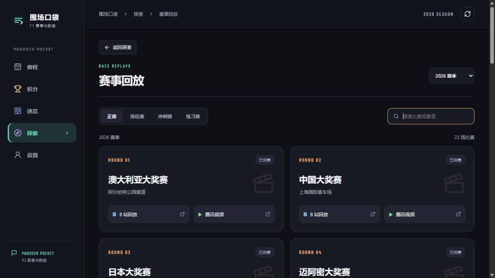

# 围场口袋 · Paddock Pocket

**面向 F1 车迷的赛事信息与观赛工具。**

围场口袋将赛程、积分、赛道天气、遥测分析与观赛入口集中在同一界面，支持手机、平板与桌面浏览器。本仓库维护网页版源码、公开资源及 Cloudflare Workers 部署配置。

**在线访问：[F1.xiaodinglab.com](https://F1.xiaodinglab.com/)** · **[赛事回放](https://F1.xiaodinglab.com/#discover/replays)**



## 功能概览

| 模块 | 功能 |
| --- | --- |
| 赛程与成绩 | 切换赛季，查看分站及比赛周末安排、发车倒计时、场次成绩与日历提醒 |
| 积分榜 | 车手与车队积分、车手头像、关注车手及相关新闻 |
| 赛道档案 | 赛道资料、立体布局与历史信息 |
| 赛道天气 | 比赛地当前天气、比赛时段预报与逐小时天气 |
| 数据分析 | 双车遥测对比、轮胎策略、技术资料与争冠积分情景分析 |
| 观赛中心 | 五星体育入口、腾讯视频网页版与 App 唤起、按设备提供的脚本安装说明 |
| 赛事回放 | 按赛季、分站和场次生成 B 站与腾讯视频检索入口，支持正赛、排位赛、冲刺赛及练习赛 |
| 探索与设置 | 精选新闻、经典比赛、F1 百科、规则资料、多套配色与时区偏好 |

回放入口使用比赛关键词检索第三方平台，不托管比赛视频。新闻为精选中文简报；赛事、遥测和技术资料的可用范围取决于上游已发布的数据。

## 项目来源与致谢

### F1Push（发车格）

本项目在赛事信息架构、比赛周末呈现、积分榜、赛道档案及数据工具的功能组织与交互设计上，**借鉴了 [F1Push（发车格）](https://f1push.com/)**。

当前版本的部分赛事、积分、遥测与技术资料也通过 F1Push 的数据服务获取，由本项目的服务端路由进行请求、参数校验与缓存。具体接入见 [`app/api/data/route.ts`](app/api/data/route.ts) 和 [`lib/tool-data.ts`](lib/tool-data.ts)。

感谢 F1Push 团队在 F1 赛事信息展示与数据工具方面的工作。围场口袋独立维护，不是 F1Push 的官方客户端；对功能和设计的借鉴不意味着取得其代码、数据或素材的统一开源授权。

### SMG 网页直播观看增强脚本

五星体育观看辅助功能采用了 **[Popukok/smg_live](https://github.com/Popukok/smg_live)** 项目的脚本，并结合本项目的使用需求提供设备适配版本与安装引导。

本仓库随附的版本包括：

| 设备 | 脚本版本 | 使用方式 |
| --- | --- | --- |
| 电脑浏览器 | 普通版 `0.24` | 通过脚本管理器加载 |
| iPhone / iPad | 主脚本与请求助手 `0.24.1` | Safari 配合 Userscripts 加载两个文件 |
| Android | 兼容版 `0.25.0` | 通过支持用户脚本的浏览器加载；Android 预览包另有独立观赛窗口 |

这些文件基于上游脚本并包含项目维护者提供的优化与适配，不保证与上游最新版本完全一致。脚本涉及播放请求、节目字段及播放器来源处理，其作用不限于界面样式调整。普通网页不会自动安装浏览器扩展，也不会自动向第三方内嵌页面注入脚本。

上游项目采用 **MIT License**。本仓库保留原作者信息及版权声明，包括 `Copyright (c) 2025 _xFox`。详见 [SMG 脚本许可证](public/user-scripts/LICENSE)、[Android 脚本许可证](public/user-scripts/ANDROID-LICENSE) 和 [版本来源与文件校验](public/user-scripts/SOURCE.md)。

### 其他数据与资源

| 来源 | 用途 | 署名与许可记录 |
| --- | --- | --- |
| [Open-Meteo](https://open-meteo.com/) | 赛道周边当前天气与预报 | 页面保留数据来源、CC BY 4.0 标注及获取时间 |
| Formula 1 官方网站及历史图片来源 | 车手头像 | [当前车手](public/drivers/credits.json) · [历史车手](public/drivers/history/credits.json) |
| [bacinger/f1-circuits](https://github.com/bacinger/f1-circuits) | 赛道坐标与立体模型基础数据 | [模型来源、修改与 MIT 许可](public/circuits/models/credits.json) |
| Barlow Project / Google Fonts | Barlow Condensed 字体 | [SIL Open Font License 1.1](public/fonts/OFL-Barlow-Condensed.txt) · [字体来源](public/fonts/sources.json) |

第三方项目、数据、图片与字体分别适用其原有许可。上述致谢不表示本项目获得相关组织的官方背书，也不将第三方内容重新声明为本项目原创。

## 技术架构

- **界面**：React 19、TypeScript、响应式 CSS。
- **构建与运行**：Vite、Vinext、Cloudflare Workers。
- **立体赛道**：Three.js。
- **数据层**：同源服务端路由、参数校验、缓存与带时间标记的快照回退。
- **持续检查**：GitHub Actions 执行类型检查、功能校验与生产构建。

```text
app/                   页面、界面组件与服务端 API 路由
lib/                   赛事、天气、遥测、回放与积分计算逻辑
public/                图片、字体、模型、脚本和下载资源
scripts/               功能校验与资源索引生成脚本
docs/                  项目文档与界面截图
.github/workflows/     持续集成配置
worker.ts              Cloudflare Worker 入口
wrangler.jsonc         Worker、静态资源与域名配置
```

## 本地开发

使用 **Node.js 24** 与 npm。依赖版本由 `package-lock.json` 锁定。

```bash
npm ci
npm run dev
```

开发服务器默认地址为 `http://127.0.0.1:5174`。

```bash
npm run check     # 类型检查与功能校验
npm run build     # 生产构建
npm run preview   # 预览已构建版本
```

修改头像源资料后，运行 `node scripts/build-portrait-index.mjs` 重新生成浏览器使用的精简索引，再执行检查。完整图片来源和版权记录继续保留。

## 部署

项目需要服务端路由，请使用 **Cloudflare Workers** 部署完整构建。

| 配置项 | 当前设置 |
| --- | --- |
| Worker 名称 | `paddock-pocket`，与 `wrangler.jsonc` 一致 |
| 生产分支 | `main` |
| 仓库根目录 | `/` |
| Node.js | `24` |
| 构建命令 | `npm run check && npm run build` |
| 部署命令 | `npm run deploy` |

将 Cloudflare 的 Git 集成连接到本仓库，并使用上表配置。部署后检查构建记录和实际线上页面；如果推送后未触发构建，可在 Cloudflare 的构建详情页使用 **Retry build** 手动触发。

通过本地命令部署时，先完成自己的 Cloudflare 登录，并根据部署目标调整 `wrangler.jsonc` 中的 Worker 名称及域名：

```bash
npx wrangler login
npm run check
npm run build
npm run deploy
```

正式地址展示为 `F1.xiaodinglab.com`；域名不区分大小写，浏览器可能将其规范化为 `f1.xiaodinglab.com`。根域名 `xiaodinglab.com` 保留兼容访问。

## 平台与数据说明

- 网页支持手机、平板与桌面浏览器；iPhone / iPad 可通过 Safari 添加到主屏幕。
- Android APK 目前作为预览版提供下载，其原生工程独立维护；本仓库以网页版和服务端部署为主。
- Apple Watch 原生应用、表盘复杂功能及智能叠放组件尚未提供。
- 赛事数据更新失败时，界面会显示可用的缓存或快照及其获取时间，不将历史快照标记为实时数据。
- 天气在页面处于前台且联网时按赛程调整更新频率：比赛场次前后更频繁，其他时段降低频率。
- 偏好设置保存在当前设备浏览器中。网站部署后，访问者使用网站不需要维护者的电脑持续开机。

## 许可证

本仓库尚未为项目自有代码设置统一的开源许可证。第三方脚本、图片、字体、赛道数据及其他资源的授权范围，以各自的许可证和来源记录为准。

感谢 F1Push（发车格）、SMG 脚本项目及所有上游数据与资源维护者。
